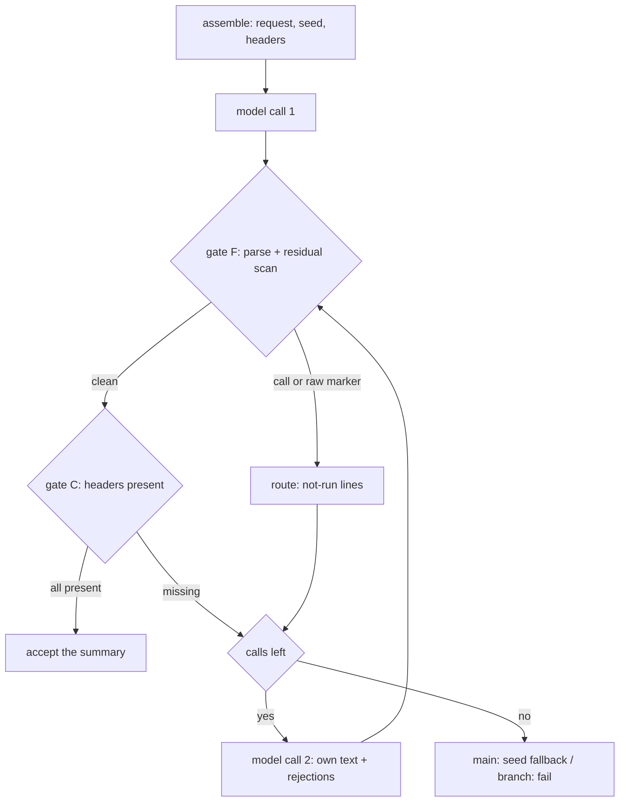

# FT-038 design: one-shot compact with the check loop

Status: the one-shot check loop is implemented and merged (FT-038).
The cut restore (section 5.4) is done. Session: `compact-degradation-next`.

## 1. Verified facts

### 1.1 The pollution evidence

The `performance-map` handoff dir holds the evidence. The polluted
versions carry Qwen-style tool-call XML. The tool names found:
`task`, `Bash`, `structured_only`, `structured_output`. Versions v3
to v6 nest parameter keys (`progress`, `files`, `key`, `decisions`,
`open`) inside the `task` call. The clean versions v1, v15, v16 are
plain markdown.

| version | state | tool name |
| ------- | ----- | --------- |
| v2      | bad   | `task`    |
| v3-v6   | bad   | `task`, nested keys |
| v7-v13  | bad   | `task`    |
| v14     | bad   | `Bash`    |
| v17     | bad   | `structured_only` |
| v18-v19 | bad   | `structured_output` |

These handoffs came from the one-shot compact path. The request
carries `tools: []`. The model context has no tool information.
The stateless model writes tool-call XML from its training data.
The tag strip from commit `82526e0` removes only the line-delimited
`think` and `tool_call` tag blocks. It does not touch this XML.

### 1.2 The parse gap (tested)

Tested `target/debug/parse` against a zero-tool config. The three
marker families, in byte form (hex, lowercase):

| family | open bytes  | close bytes | inner form |
| ------ | ----------- | ----------- | ---------- |
| A      | `0a 3c 69 6e 76 6f 6b 65 3e`   | `0a 3c 69 6e 76 6f 6b 65 3e`   | JSON call object or array |
| P      | `0a 3c 69 6e 76 6f 6b 65`      | `0a 3c 2f 69 6e 76 6f 6b 65`   | name line, bare parameter keys |
| Q      | `0a 3c 74 6f 6f 6c 5f 63 61 6c 6c 3e` | `0a 3c 2f 74 6f 6f 6c 5f 63 61 6c 6c 3e` | `3c 66 75 6e 63 74 69 6f 6e 3d` name line, `3c 70 61 72 61 6d 65 74 65 72 3d` KEY / `3c 2f 70 61 72 61 6d 65 74 65 72 3e` pairs |

The Q family is the Qwen shape. It starts a line with a `tool_call`
open tag (hex above). It holds a `function=NAME` line and
`parameter=KEY` / `/parameter` pairs, then a `/function` line and
the closing tag.

Test results on the current parse binary:

| input | result |
| ----- | ------ |
| one Q block | exit 2. The XML stays in the assistant text |
| two Q blocks | exit 2. Error event: the block does not parse |
| A family block | exit 1. The call is extracted and routed |
| P family block | exit 1. The call is extracted and routed |

The A and P families work. The Q family does not. One Q block passes
through as prose. That is the pollution channel.

### 1.3 The check mechanism works today

`parse` with the zero-tool config emits the `tool_call` event and
exits 1. `route` with no tool path returns the not-run
`tool_result` (FT-026 message):

> Unknown tool bash. No tool ran. The available tools are: (none).
> Re-issue the call using one of the available tool names.

The compact loop can reuse both binaries without a change.

### 1.4 The config merge

`config_layer` deep merge: a top array replaces the base array.
A zero-tool top layer (`native_tool_paths = []`,
`extension_tool_paths = []`) overrides the Nix store base. parse
then sees an empty valid set. Every detected call is unknown.

### 1.5 The cascade root cause (current main)

The compact agent C runs with `compact_enabled = false`
(`write_compact_config`, compact main.rs L1102). C's seeded context
overflows the 262144 window. `step/model.rs` fires a forced
last-resort compact at four sites. None of them checks
`cfg.compact_enabled`:

1. L684-694: an overflow error, compact disabled or already
   recovered. A forced `LastResort` compact fires.
2. L882-889: a successful call, measured input at or over the
   overflow budget, compact disabled. A forced `LastResort` fires.
3. L918-928: a length stop, the second pass. A forced `LastResort`
   fires.
4. L331-364: the `context_exhausted` handler. Both branches fire a
   forced `LastResort`.

`force = true` bypasses the `enabled` gate in `decide_trigger`
(compact main.rs L186). So C compacts its own session. It spawns C1.
C1 overflows too. The m11 log shows six levels
(`m11-churn-hoist-compact-v6` down to
`...-v1-compact-v1-compact-v1-compact-v1-compact-v1`).

## 2. Design

User decisions on record (this session and its predecessor):

1. The one-shot mechanism is the one compact mechanism. The agent
   fork is deprecated.
2. A second chance is a second model call, not a re-cut of the
   window.
3. The check loop uses the existing `parse` and `route` binaries.
4. The model-free seed transcript stays as the liveness fallback
   only. It is not the solution.
5. Format gate: reject any tool name. The compact tool set is
   empty, so every detected call is a reject.
6. Content gate: read the header list from the template, not from
   a hard-coded list in compact.

### A. parse: add the Q family

Add the Q family to `extract_text_tool_calls`. A closed Q block
yields one call: name = the `function=NAME` value, arguments = the
`parameter=KEY` object. No parameter keys: an empty object. An
unterminated Q block keeps its text as prose (the existing rule
for unterminated markers). The family joins the A and P families in
the same byte-scan loop.

This also recovers Q-family text calls in the main agent loop.
The agent loop gets the same fix.

### B. compact: the one-shot check loop

Replace the agent fork in `run_session_summary` with
`summarize_one_shot`. Flow:

Steps:

1. Run assemble three times against the target region:
   - `--summary-input` (the target flag, P config): the bounded
     request JSON, `tools: []`.
   - `--summary-input --summary-text`: the bounded transcript.
     This is the fallback seed.
   - `--compact-headers`: the list of headers the summary needs
     (component C).
2. Model call 1: run the `model` binary (sibling, `--config` P
   config) with the request JSON.
3. Check loop, `MAX_SUMMARY_CALLS` (2) calls at most:
   - Feed the response JSON to `parse` with a zero-tool config
     (a temp file: empty `native_tool_paths` and
     `extension_tool_paths`).
   - Gate F (format): fail when parse emits a `tool_call` event,
     or an error event, or when the emitted text still carries an
     open marker of any family (residual scan).
   - Gate F failed: feed the emitted `tool_call` events to
     `route` (no tool path flag). Collect the not-run lines.
     Build the second-call context. Go to step 4.
   - Gate C (content): every header on the template list is
     present in the text. If any is missing, fail with the list.
   - Both gates pass: accept the text.
4. The second call: the original request plus two `input` items:
   - a `message`/`assistant` item with the failed response text,
     raw, markers and all.
   - a `message`/`user` item with the correction block (below).
   Run `model` again. Repeat step 3.
5. Retries exhausted:
   - Main target: the seed transcript from step 1 is the summary
     (liveness, the existing guarantee).
   - Branch target: `fail_and_exit` (the P4 contract, unchanged).
6. The `compaction_summary` marker keeps its shape. One-shot fills
   its optional `usage` field with the accepted call's usage. The
   compact binary writes the versioned file for its target
   (`handoff/v<N>.md` main, `branch-summary/v<N>.md` branch). A
   loop-driven compact gets the same file from the loop writer.
   Both writes carry the same text. The duplicate is harmless.

Correction block (the user message of the second call):

- Gate F failed with calls:
  "Your last response did not produce a valid summary. The tool
  calls in it did not run: [one route line per call] No tools are
  available in this session. Do not call tools. Write the full
  summary now as plain text, with every section the instructions
  need."
- Gate F failed without calls (raw markers only):
  "Your last response carried raw tool-call markers. No tools are
  available in this session. Do not call tools. Write the full
  summary now as plain text, with every section the instructions
  need."
- Gate C failed (headers missing):
  "Your last summary is missing sections from the template: [list].
  Rewrite the full summary now, with every section, as plain
  text."

Gate F takes precedence over gate C. The format must be clean
before the content is trusted.

Implementation note (the `headers_args` pitfall, found 2026-11-04):
build the header argument list as separate tokens. The first version
used `vec!["--compact-headers", filtered.collect()]`. That merged
the remaining base tokens into one string. The merge glued `--config`
to the token before it. The `assemble` stub read an empty `--config`
and looked for `headers.json` in the current directory.

The compact-loop test caught the merge. The fix is
`iter::once("--compact-headers").chain(filtered).collect()`. It keeps
every flag and value as its own element.

A model API failure (stop reason `error`) gets no second chance.
It falls back (main) or fails (branch), as today.

### C. assemble: two additions

1. `--compact-headers`: print the header list the summary needs as
   a JSON array. Rule: the `##` and `###` lines of the active
   instruction text (the FIRST template, or the previous-summary
   block of the UPDATE template). If the text carries no headers,
   print the FIRST-template set (nine headers).
2. A notice line in the summary-input instructions: "No tools are
   available in this session. Reply with the summary text only."
   The line informs the model. The check loop still guards the
   result.

### D. model.rs: gate the forced compacts

Deferred by decision 5 (section 3). The last-resort compact stays the
fatal-overflow safety net, so no `model.rs` change. The target state,
if it is later chosen, would gate every forced compact site:

Every forced compact site in `step/model.rs` runs only when
`cfg.compact_enabled` is true:

1. L684: compact disabled, overflow error: a terminal error event,
   no compact.
2. L882: compact disabled, silent overflow on a success: skip the
   compact, the loop continues.
3. L918: compact disabled, length stop second pass: stop the step
   with an error event, no compact.
4. L331/L357: the `context_exhausted` handler: gate both branches.
   A disabled session logs an error and stops the step.

### E. Remove the agent orchestration

Delete from compact: the fork path, `seed_agent_log`,
`write_compact_config`, `resolve_write_handoff_tool_dir`, the
`--rushi` flag use in the summary path. The `write-handoff` tool
dir stays shipped (distribution surface, other users may mount it
by hand). No agent C dir is created anymore.

## 3. Decisions (settled 2026-11-03)

1. Retry count: the loop runs up to 3 model calls by default. The
   count is a config knob under `[limits]`: `compact_max_summary_calls`
   (default 3, minimum 1). Value 1 disables the second chance.
2. No `source` field on `compaction_summary`. No schema update.
   The fallback stays observable through the compact stderr line and
   the summary content (a raw transcript, no template headers).
3. The emergency human-rewrite route (`rushi compact` subcommand)
   is deferred. The compact work must be healthy first.
4. The agent orchestration is deleted in the same commit series as
   the one-shot.
5. Step D is kept as is. The last-resort compact stays the
   fatal-overflow safety net. The kill switch holds the proactive and
   normal-overflow compacts. A fatal overflow is still rescued by the
   last-resort. Step D is deferred until the compact work is healthy.

## 4. Test plan

- parse unit tests: Q-family extraction. With parameters, without,
  two blocks, a truncated block.
- compact loop test: a stub model binary returns a polluted text
  first and a clean text second. Assert the call count, the route
  lines, and the accepted text.
- Gate tests: a missing-header response, a raw-marker-only
  response, an API-failure response.
- model.rs: the disabled-compact overflow path emits a terminal
  error and never invokes the compact binary.
- End to end on m11: run the real model. The new handoff version
  must be clean plain markdown.

## 5. The cut and trigger: the pre-FT-033 baseline

The FT-037 walk-back regressed the cut. It replaced the
`compact_keep_tokens` detail budget with a trigger-fitting budget
(`trigger_level - summary_budget`). The compact now noops on a
session with large tool schemas. This section records the correct
baseline (failure-tracking FT-038).

### 5.1 The trigger threshold (pre-FT-033)

The trigger level is `context_budget - compact_reserve_tokens`
(pi parity). The decisive trigger reading is the event estimate
(`estimate_from_events`, uncapped, calibrated, rewind-aware),
appended as the last reading. The threshold trigger fires when that
estimate is at or over the trigger level. The overflow and force
reasons skip the trigger test.

### 5.2 The cut: `compact_keep_tokens` is a detail budget

`compact_keep_tokens` (default 20000) is the token count of the tail
that survives a compaction. The tail is the most recent events of the
active context, before the compaction. It preserves the real details
of the ongoing work. The model picks up from the kept tail, not just
the summary.

The post-compact context is:

    [system prompt + tool schemas] + [summary] + [compact_keep_tokens]

The FT-037 cut replaces this with `trigger_level - summary_budget`.
That is a trigger-fitting budget. It does not count the tool schemas
and system prompt. For a session whose event estimate is under that
budget, `find_cut` returns 0 and the compact noops.

### 5.3 The concrete failure

The `m11-churn-hoist-follow` session. The model input is 260448
tokens, over the 245760 trigger. The event estimate is 174516.

The FT-037 keep budget is 180224. Since 174516 is under 180224,
`find_cut` returns 0. The compact noops. The pre-FT-033 cut
(compact_keep_tokens = 20000) cut it.

### 5.4 The fix

Restore the pre-FT-033 cut. `find_cut` keeps `compact_keep_tokens`
tokens of the tail. The post-compact context is
`[system prompt + tool schemas] + [summary] + [compact_keep_tokens]`.
The FT-038 check loop (section 2, gate F and gate C) stays. It
rejects the malformed responses.

Implemented: `find_cut` takes the keep budget. `run_compaction` reads
`compact_keep_tokens` (default 20000).

### 5.5 The failure designs

FT-033 (the agent fork), FT-036 (the raw seed), and FT-037 (the
trigger-fitting cut) are failure designs. The pre-FT-033 one-shot is
the working baseline for the cut. The recurring symptom they share:
the one-shot compact call predating FT-033 and FT-038 often returns
malformed format and content.
